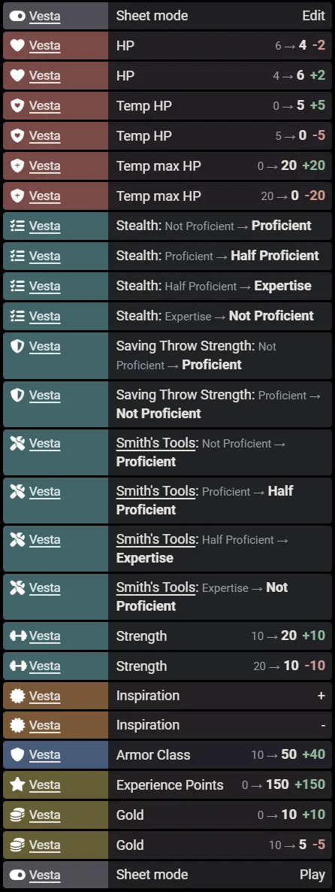
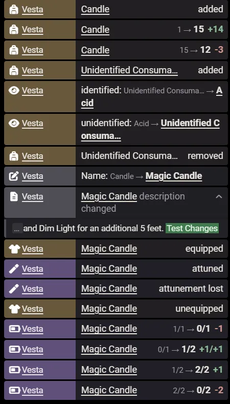
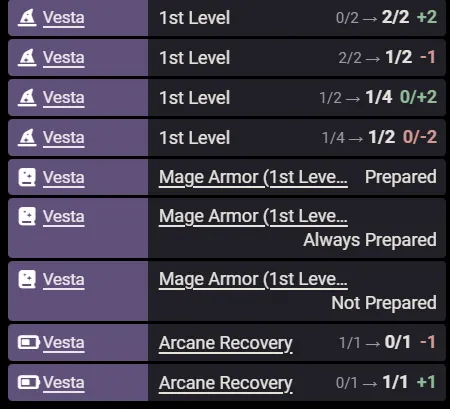
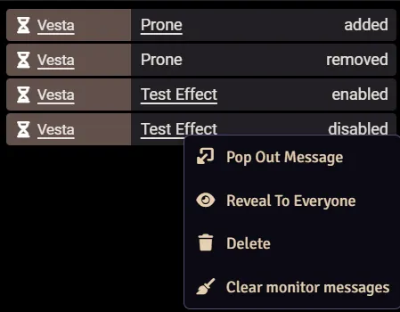
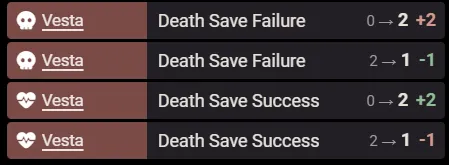

# Simraki's Character Monitor

**Simraki's Character Monitor** is an advanced sheet monitoring module for **D&D5e**.

The module automatically logs changes made to character, NPC or Party sheets directly into the chat, allowing the GM
to passively observe progression, inventory management, and tactical updates. It features powerful privacy controls and
filtering options to seamlessly integrate into any table's playstyle.

---

## Key Features

### Advanced Log Visibility

Every monitored parameter has one of four visibility levels:

- **Disabled**: nothing is logged for this parameter.
- **GM Only**: messages are whispered to the GMs.
- **GM & Token Owner**: messages are whispered to the GMs and the owners of the character.
- **Everyone**: messages are public.

Most parameters default to **GM Only**

### NPC Sheet Monitoring

The **NPC Monitoring** setting extends monitoring beyond player characters:

- **Disabled** (default): only player characters are monitored.
- **Player-controlled**: NPCs owned by at least one player.
- **All**: every NPC (may flood the chat in heavy combat).

### Party Sheet Monitoring

The **Party Sheet Monitor** setting (off by default) extends monitoring to Party (Group) sheets: members, currency and
items in the shared inventory, each with its own visibility setting.

---

## What Is Monitored

- Current, maximum, temporary and temporary maximum HP
- Hit dice
- Armor class
- XP
- Level (class levels)
- Ability scores
- Skill, saving throw and tool proficiencies
- Currency (on the sheet and in containers)
- Spell slots, including pact magic
- Spell preparation (prepared, not prepared, always prepared)
- Items: added and removed, quantity, equipped, attunement, identification, charges, moves between containers
- Item names and descriptions
- Active effects: added, removed, enabled, disabled
- Inspiration
- Death save successes and failures
- Sheet mode (play / edit)
- Party members (party sheets only)

*Spells and features are also included in the "Item"*

---

## How Messages Look

Each change creates a two-zone chat message:

- **Left zone**: Color-coded by category (health, defense, magic, gear, skills, wealth, inspiration, effects, other)
  with an icon and a short character name. Hovering anywhere over the left zone shows a tooltip with the full character
  name, who made the edit, and when.
    - **Author mark**: A corner crown (GM) or person-pen (player) badge indicates edits made by someone else
- **Right zone**: Shows the change (e.g., `HP 15 → 10 -5`, `Candle 1/2 → 2/3 +1/+1`, `Stealth: Proficient → Expertise`).
  Old values appear smaller; deltas are green or red and hidden if ≥ 10,000. Pools display as fractions, and long values
  wrap to the next line.

### Batching

Changes to the same character are buffered for **Batch time** (600 ms from the first change by default) and sent to the
GM together, while still rendering as individual messages

### Context Menu

Right-click any monitor message and select **Clear monitor messages** (GM only) to delete all messages created by this
module after confirmation

---

**Player Monitoring**

**Item Monitoring**

**Spell Monitoring**

**Effect Monitoring**

**Death Save Monitoring**

---

## Acknowledgements

This module is based on ideas and prior work from:

- jessev14 & enso
    - https://github.com/jessev14/dnd5e-character-monitor
- Shr1mps
    - https://github.com/Shr1mps/dnd5e-character-monitor
- nschoenwald
    - https://github.com/nschoenwald/tiny-hp-monitor

---

## Other my modules

- **[Simraki's Radial Effects](https://foundryvtt.com/packages/simraki-radial-effects)** - active effects icons in
  circular ring or pattern around character tokens
- **[Simraki's Cursed Items](https://foundryvtt.com/packages/simraki-cursed-items)** - adds support for cursed items
  in D&D5e

---

## License

This package is under an [MIT](LICENSE) license and
the [Foundry Virtual Tabletop Limited License Agreement for module development](https://foundryvtt.com/article/license/).
